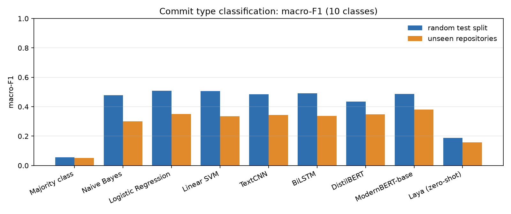

# What kind of change is this? Commit-type classification

**COE025 Natural Language Processing, Project 1 (Text Classification)**
Team **Out of Vocabulary (OOV)**: İlyas Güney, Eren Taşkın, Nuri Tayfun Akbeniz

Given only the description of a code change (a git commit subject), predict its **type**:
`feat`, `fix`, `docs`, `refactor`, `test`, `perf`, `build`, `ci`, `chore` or `style`.

```
"handle trailing slash in lazy routes"         -> fix
"add support for custom element tags"          -> feat
"move route matching into a separate module"   -> refactor
```

* **Dataset:** built by us, 121,276 commit messages from 26 MIT / Apache-2.0 open-source repositories,
  labeled automatically from their Conventional Commits headers (the label is removed from the text).
* **Metric:** macro-F1, because the classes are imbalanced 90:1.
* **Methods:** 7 baselines from the course (Majority, Naive Bayes, Logistic Regression, Linear SVM, TextCNN,
  BiLSTM, DistilBERT) and 2 new methods (fine-tuned ModernBERT, zero-shot Laya decision model).
* **Two test sets:** a random split and five repositories the models never saw.

## Results

Full report: **[results/benchmark.md](results/benchmark.md)** (generated by `src/benchmark.py`).
Primary metric: macro-F1 over 10 classes.

| Model | Group | Test macro-F1 | Unseen-repos macro-F1 | Unseen-repos accuracy |
|---|---|---|---|---|
| Majority class | baseline | 0.055 | 0.051 | 0.341 |
| Naive Bayes | baseline | 0.478 | 0.301 | 0.491 |
| **Logistic Regression** | baseline | **0.508** | 0.351 | 0.554 |
| Linear SVM | baseline | 0.506 | 0.336 | 0.530 |
| TextCNN | baseline | 0.485 ± 0.005 | 0.345 | 0.552 |
| BiLSTM | baseline | 0.491 ± 0.001 | 0.337 | 0.537 |
| DistilBERT | baseline | 0.435 | 0.347 | **0.581** |
| **ModernBERT-base** | **new** | 0.486 | **0.382** | 0.577 |
| Laya (zero-shot) | **new** | 0.188 | 0.158 | 0.162 |



**Main findings**

1. **The task is hard.** The best model reaches 0.51 macro-F1. Commit types are chosen by the authors and their
   definitions overlap (`refactor` vs `chore` vs `style`, `fix` vs `perf`), so labels are noisy. The rare classes
   suffer most: `perf` and `style` are mostly predicted as `fix`.
2. **On the random split, a linear model on TF-IDF is the best.** Logistic Regression (0.508) beats every neural
   model. Commit subjects are short and keyword-driven (`optimize`, `typo`, `workflow`, `add tests`), which
   n-gram features capture well with 85k training examples.
3. **On unseen repositories, ModernBERT is clearly the best (0.382 vs 0.351).** All models lose 13–18 points on
   projects they never saw, because each project has its own vocabulary and habits. ModernBERT, pre-trained on code
   and text, transfers best, although it was fine-tuned on only 20k of the 85k training commits.
4. **Zero-shot is not enough.** Laya, given only the label definitions, reaches 0.188 macro-F1 (3.4× the majority
   baseline). It strongly over-predicts `refactor`, whose definition ("neither fixes a bug nor adds a feature")
   works as a catch-all, and almost never predicts `fix`. Learning the convention from labeled data matters.

**Compute notes (CPU only, no GPU).** DistilBERT and ModernBERT were fine-tuned on the same stratified 20,000-commit
subset for 2 epochs (early stopping on a 3,000-commit validation sample); their validation score was still rising,
so they are under-trained compared with the classical models. Laya was evaluated on stratified samples of 2,000
commits per test split.


## Repository layout

```
.
├── configs/repos.yaml          the 26 source repositories and their licenses
├── data/
│   ├── raw/commits_raw.csv.gz  raw commits as collected (179,960 rows)
│   └── processed/
│       ├── commits_clean.csv   cleaned and labeled dataset (121,276 rows)
│       ├── cleaning_report.json rows removed by every cleaning step
│       ├── train.csv / val.csv / test.csv   random stratified 80/10/10 split
│       └── test_unseen_repos.csv            5 held-out repositories
├── src/
│   ├── collect.py              1. clone repositories (commit-only) and read git log
│   ├── clean.py                2. label from the header, strip type/scope, clean, deduplicate
│   ├── split.py                3. create the random and unseen-repository splits
│   ├── common.py               shared loading, label definitions and evaluation
│   ├── train_classical.py      4a. Majority, Naive Bayes, Logistic Regression, Linear SVM
│   ├── train_neural.py         4b. TextCNN and BiLSTM trained from scratch (3 seeds)
│   ├── train_transformer.py    4c. DistilBERT / ModernBERT fine-tuning
│   ├── zero_shot_laya.py       4d. Laya zero-shot decision model
│   └── benchmark.py            5. results/benchmark.md and figures
├── results/                    one JSON per model, benchmark.md, figures/
├── docs/
│   ├── preprocessing.md        data pipeline documentation (every cleaning rule and its effect)
│   ├── research.md             problem definition, label set, metric and method choices
│   └── results.md              analysis of the results and error analysis
├── contributions/              one file per team member
├── Makefile                    runs the whole pipeline
├── requirements.txt            pinned dependencies
└── LICENSE                     MIT for code, data notice for the commit messages
```

## How to reproduce

```bash
python3.12 -m venv .venv && source .venv/bin/activate
pip install torch==2.14.1 --index-url https://download.pytorch.org/whl/cpu
pip install -r requirements.txt

make all          # or step by step:
make data         # collect + clean          (~10 min, needs git and internet)
make splits       # train/val/test + unseen repositories
make classical    # ~8 min on CPU
make neural       # TextCNN + BiLSTM, 3 seeds each
make transformers # DistilBERT + ModernBERT fine-tuning (CPU, slow)
make zeroshot     # Laya, downloads a 421M-parameter checkpoint
make benchmark    # writes results/benchmark.md and results/figures/
```

The cleaned data and the splits are committed, so the model steps can be run without `make data`.
All random steps use a fixed seed (42; neural models 42/43/44). Everything runs on CPU; the numbers in
`results/` were produced on a 16-thread laptop CPU without a GPU.

## Data

See **[docs/preprocessing.md](docs/preprocessing.md)** for the full pipeline. In short:

1. `collect.py` makes commit-only bare clones of the repositories in `configs/repos.yaml` and stores up to
   8,000 recent non-merge commits per repository. Author names and e-mails are not stored.
2. `clean.py` parses `type(scope)!: subject`, maps type aliases to 10 labels, **removes the type and scope
   from the text** (otherwise the label would leak into the input), removes bots, dependency/release
   commits, URLs, issue numbers and hashes, non-English and too short/long subjects, ambiguous duplicates
   and exact duplicates.
3. `split.py` creates a stratified 80/10/10 split and a separate test set of five unseen repositories.

| label | count | | label | count |
|---|---|---|---|---|
| fix | 45,723 | | test | 5,157 |
| docs | 18,244 | | build | 4,454 |
| feat | 17,425 | | ci | 2,321 |
| chore | 15,316 | | perf | 2,039 |
| refactor | 10,089 | | style | 508 |

## Why macro-F1

`fix` is 37.7% of the data and `style` 0.4%. A model that always predicts `fix` reaches 38% accuracy
(see the majority-class row) but is useless. Macro-F1 averages the F1 of every class with equal weight, so
it only rewards models that also recognise the rare types (`perf`, `ci`, `style`), which is what a changelog
or release tool needs. We also report accuracy, weighted-F1, per-class F1 and confusion matrices.

## Methods

Vanilla methods from the lectures are **baselines**; methods beyond the course are **new**.

| Method | Group | Architecture → concrete model / setup |
|---|---|---|
| Majority class | baseline | always predicts `fix`; lower bound |
| Naive Bayes | baseline | Multinomial NB on TF-IDF word 1-2 grams, alpha tuned on val |
| Logistic Regression | baseline | TF-IDF word 1-2 grams, C tuned on val |
| Linear SVM | baseline | TF-IDF word 1-2 grams, C tuned on val |
| TextCNN | baseline | CNN (Kim 2014) → our model: 128-d embeddings from scratch, filters of width 2/3/4/5 × 100, max pooling, dropout 0.5 |
| BiLSTM | baseline | bidirectional LSTM → our model: 128-d embeddings from scratch, 128 hidden units per direction |
| DistilBERT | baseline | BERT (Transformer encoder) → `distilbert-base-uncased`, 66M parameters, fine-tuned |
| ModernBERT | **new** | Transformer encoder (2024; RoPE, alternating local/global attention, pre-trained on text **and code**) → `answerdotai/ModernBERT-base`, 149M parameters, fine-tuned |
| Laya | **new** | zero-shot typed-decision model, open-source alternative to JEV → `convaiinnovations/laya` (ModernBERT-large, 421M); gets only the 10 label definitions, **no training data** |

Model selection always uses the validation split; the test splits are evaluated once.

## Team

| Member | Student ID | Role |
|---|---|---|
| İlyas Güney | 2309111030 | implementation: data pipeline, models, benchmark |
| Nuri Tayfun Akbeniz | 210911043 | research: problem definition, label set, metric and method choices |
| Eren Taşkın | 2309111067 | analysis and presentation: result interpretation, error analysis, slides |

Details of each member's work are in [`contributions/`](contributions/).

## License

Code: MIT (see `LICENSE`). Data: commit messages from MIT / Apache-2.0 repositories, see the data notice in
`LICENSE` and `configs/repos.yaml`.
