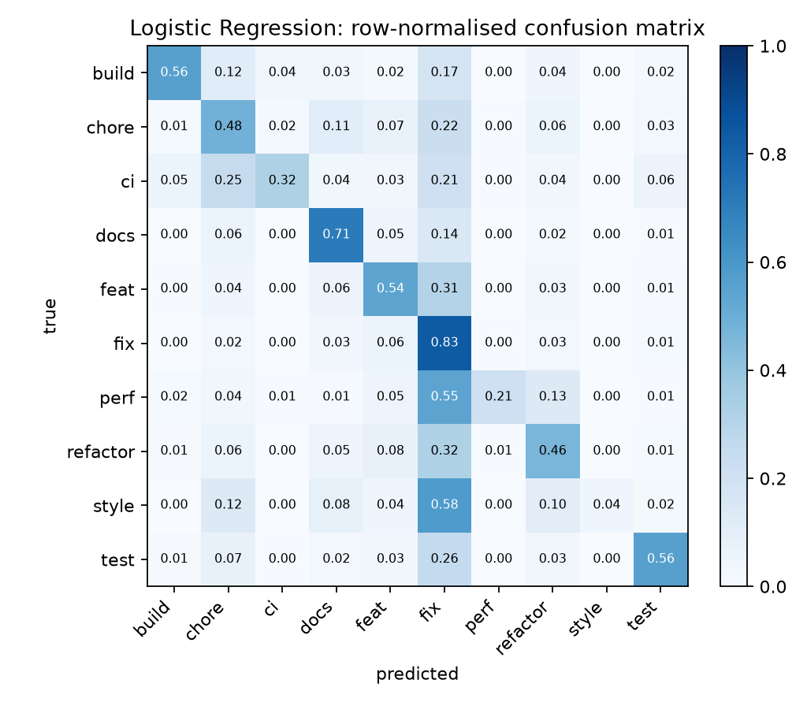

# Benchmark

Generated by `src/benchmark.py` from `results/*.json`. Primary metric: **macro-F1** (see README, *Why macro-F1*).

## Main results

| Model | Type | Test macro-F1 | Test accuracy | Unseen-repos macro-F1 | Unseen-repos accuracy | Train time (s) |
|---|---|---|---|---|---|---|
| Majority class | baseline (classical) | 0.055 | 0.382 | 0.051 | 0.341 | 1.1 |
| Naive Bayes | baseline (classical) | 0.478 | 0.612 | 0.301 | 0.491 | 6.2 |
| Logistic Regression | baseline (classical) | **0.508** | 0.653 | 0.351 | 0.554 | 323.9 |
| Linear SVM | baseline (classical) | 0.506 | 0.643 | 0.336 | 0.530 | 46.9 |
| TextCNN | baseline (neural, from scratch) | 0.485 (±0.005) | 0.636 | 0.345 | 0.552 | 358.0 |
| BiLSTM | baseline (neural, from scratch) | 0.491 (±0.001) | 0.634 | 0.337 | 0.537 | 319.4 |
| DistilBERT | baseline (pretrained transformer) | 0.435 | 0.619 | 0.347 | 0.581 | 1813.6 |
| ModernBERT-base | new method (pretrained transformer) | 0.486 | 0.633 | 0.382 | 0.577 | 5313.2 |
| Laya (zero-shot) | new method (zero-shot decision model, JEV alternative) | 0.188 | 0.186 | 0.158 | 0.162 | 0.0 |

- TextCNN: median of seeds [42, 43, 44]; ± is the std over seeds.
- BiLSTM: median of seeds [42, 43, 44]; ± is the std over seeds.
- DistilBERT was fine-tuned on a stratified subsample of 20000 training commits (CPU budget).
- ModernBERT-base was fine-tuned on a stratified subsample of 20000 training commits (CPU budget).
- Laya is evaluated on stratified samples of {'test': 2000, 'test_unseen_repos': 2000} commits (CPU inference cost); it uses no training data.

## Per-class F1 (random test split)

| Model | build | chore | ci | docs | feat | fix | perf | refactor | style | test |
|---|---|---|---|---|---|---|---|---|---|---|
| Majority class | 0.000 | 0.000 | 0.000 | 0.000 | 0.000 | 0.553 | 0.000 | 0.000 | 0.000 | 0.000 |
| Naive Bayes | 0.608 | 0.507 | 0.455 | 0.652 | 0.491 | 0.720 | 0.277 | 0.455 | 0.127 | 0.486 |
| Logistic Regression | 0.648 | 0.524 | 0.399 | 0.714 | 0.573 | 0.746 | 0.296 | 0.504 | 0.074 | 0.605 |
| Linear SVM | 0.643 | 0.504 | 0.443 | 0.708 | 0.552 | 0.743 | 0.306 | 0.488 | 0.069 | 0.601 |
| TextCNN | 0.590 | 0.490 | 0.399 | 0.705 | 0.569 | 0.742 | 0.221 | 0.485 | 0.075 | 0.571 |
| BiLSTM | 0.608 | 0.506 | 0.393 | 0.695 | 0.567 | 0.739 | 0.273 | 0.494 | 0.038 | 0.599 |
| DistilBERT | 0.506 | 0.433 | 0.174 | 0.696 | 0.552 | 0.741 | 0.234 | 0.462 | 0.000 | 0.554 |
| ModernBERT-base | 0.560 | 0.480 | 0.361 | 0.712 | 0.557 | 0.745 | 0.329 | 0.458 | 0.073 | 0.587 |
| Laya (zero-shot) | 0.164 | 0.173 | 0.095 | 0.362 | 0.093 | 0.082 | 0.200 | 0.252 | 0.024 | 0.438 |

## Figures

